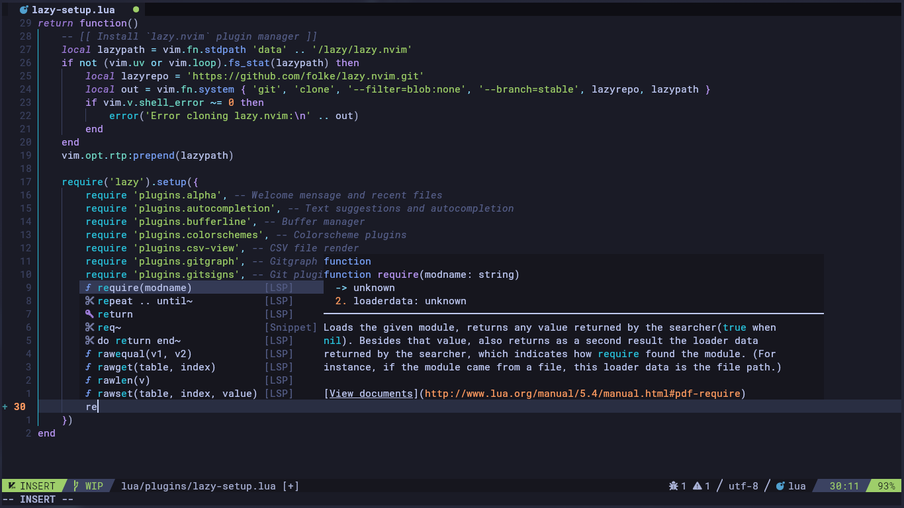
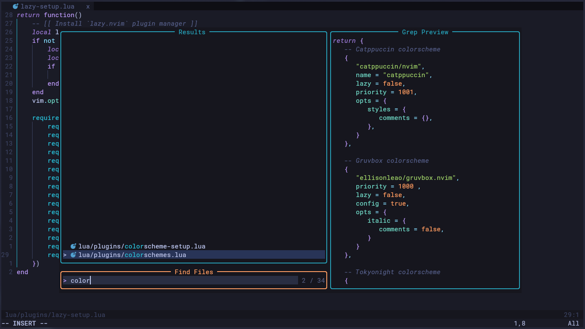
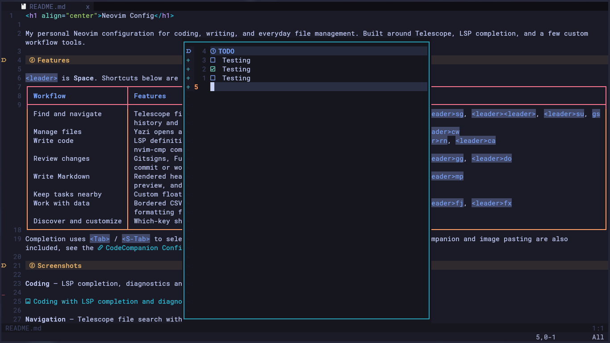
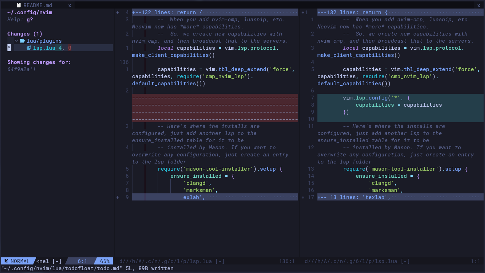
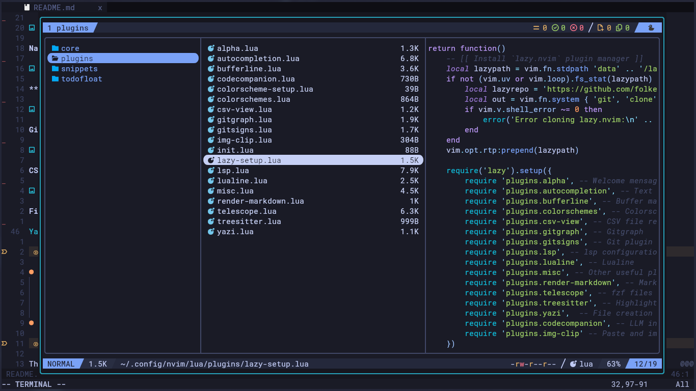

<h1 align="center">Neovim Config</h1>

My personal Neovim configuration for coding, writing, and everyday file management. Built around Telescope, LSP completion, and a few custom workflow tools.

## Features

`<leader>` is **Space**. Shortcuts below are for Normal mode. These are some of the many shortcuts and features.

| Workflow | Features | Try it |
| --- | --- | --- |
| Find and navigate | Telescope file search, live grep, buffer switching, undo history and flash jumps | `<leader>sf`, `<leader>sg`, `<leader><leader>`, `<leader>su`, `gs` |
| Manage files | Yazi opens at the current file or working directory | `<leader>-`, `<leader>cw` |
| Write code | LSP definitions, references, rename, and code actions, nvim-cmp completion and LuaSnip snippets | `gd`, `gr`, `<leader>rn`, `<leader>ca` |
| Review changes | Gitsigns, Fugitive, GitGraph history, and Diffview for commit or working-tree changes | `<leader>fg`, `<leader>gg`, `<leader>do` |
| Write Markdown | Rendered headings and custom task states, browser preview, and personalized snippets | `<leader>mk`, `<leader>mp` |
| Keep tasks nearby | Custom floating TODO window backed by a Markdown file | `<leader>td` |
| Work with data | Bordered CSV tables, log highlighting, and JSON/XML formatting from the clipboard | `<leader>tc`, `<leader>fj`, `<leader>fx` |
| Discover and customize | Which-key shortcut hints and a persistent theme picker | `<leader>th` |

Completion uses `<Tab>` / `<S-Tab>` to select suggestions and `<C-y>` to accept them in Insert mode. CodeCompanion and image pasting are also included, see the [CodeCompanion Configuration](#codecompanion-configuration) section.

## Screenshots

**Coding** — LSP completion, diagnostics and syntax highlighting.



**Navigation** — Telescope file search with a live source preview.



**Writing and tasks** — Rendered Markdown with the custom floating TODO window.



**Git review** — Browse commit history and inspect changes with Diffview.



**File management** — Yazi inside Neovim.



## Directory Structure

- **lua/** – Main Lua configuration:
    - **lua/core/** – Keymaps and core configuration files
    - **lua/plugins/** – Plugin configurations
    - **lua/snippets/** - Personalized snippets
    - **lua/todofloat/** – Custom floating TODO window plugin
- **lsp/** - Per-server LSP configuration overrides

## Installation

This setup is primarily designed for Arch Linux, but it can also work on Windows with a few adjustments. See the [Extra](#extra) section for details.
For workflow-specific dependencies and defaults, see [Configuration Notes](#configuration-notes).

### Prerequisites
---

Install Neovim and Git, and use a Nerd Font in your terminal for the configured icons. The configuration uses `vim.lsp.config`, your Neovim installation must support that API. Install the `yazi` executable to use the file manager.

#### Python

Some Neovim plugins require Python. For Arch-based distros, install with:

```bash
sudo pacman -Syu
sudo pacman -S python python-pip
```

#### Gcc and Make

Gcc and make are required to compile some dependencies. Install the necessary tools with:

```bash
sudo pacman -Syu
sudo pacman -S base-devel
```

On Windows, another step is needed for treesitter to work, run the command or just insert this line at the `$PROFILE` file:

```powershell
$env:CC="gcc"
```

#### LaTeX

LaTeX highlighting requires extra packages. First, install Node.js and npm:

```bash
sudo pacman -Syu
sudo pacman -S nodejs npm
```

Then install tree-sitter-cli for LaTeX highlighting:

```bash
npm install -g tree-sitter-cli
```

#### Telescope Dependencies

For Telescope to work, `fd` and `ripgrep` are needed:

```bash
sudo pacman -Syu
sudo pacman -S fd ripgrep
```


#### Formatter Keymaps Dependencies

The configuration currently supports XML and JSON formatting from the clipboard, but for it to work, `jq` and `xmllint` are needed:

```bash
sudo pacman -Syu
sudo pacman -S jq libxml2
```

#### CodeCompanion Configuration

CodeCompanion is already enabled in [lazy-setup.lua](./lua/plugins/lazy-setup.lua). The current [codecompanion.lua](./lua/plugins/codecompanion.lua) configuration selects the `codex` ACP adapter for chat and inline interactions.

To use another provider, adjust `adapters` and `interactions` in that file. Image pasting is configured in [img-clip.lua](./lua/plugins/img-clip.lua).

### Setup Steps
---

1. Clone this repository and move all files to your Neovim configuration folder;
2. In `init.lua`, change the TODO `target_file` to an existing Markdown file, or use `require("todofloat").setup()` to use the bundled `lua/todofloat/todo.md`;
3. Open Neovim, plugins will be installed automatically via lazy.nvim;
4. Run `:checkhealth` to check local dependencies and `:Mason` to inspect language-server installations.

#### Extra

1. If you encounter LSP installation errors, run `:MasonLog` in Neovim, follow the instructions, and install any missing packages.
2. Windows settings:
    - The terminal shortcut (`<leader>\`) launches `pwsh.exe`, so install PowerShell 7 or adjust the shell in `lua/core/keymaps.lua`.
    - GitGraph automatically uses its default symbols on Windows.
    - Files with things that need changing depending on the system you're in have a *TODO* comment right above them with instructions.

## Final Notes

This configuration is tailored to my daily workflow, featuring essential plugins I find useful. Feel free to customize as you like.
